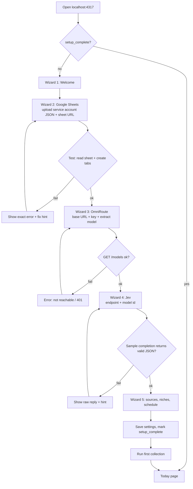
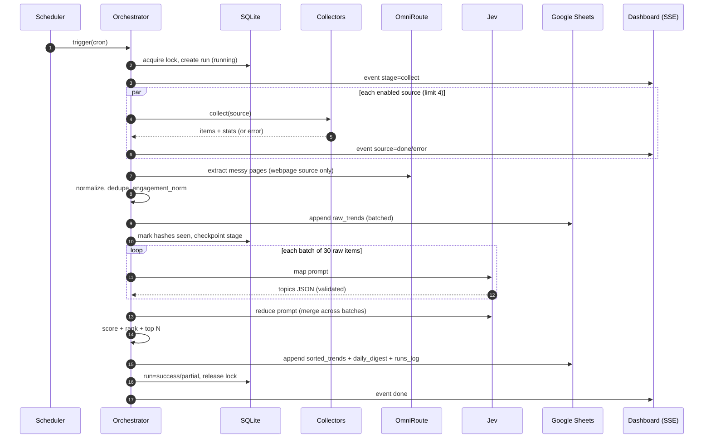
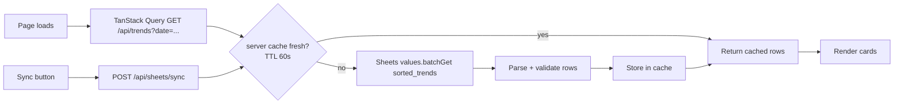

# 04 — App Flow

## 1. First-run setup flow



Rules: each step saves on success; closing the browser resumes at the last incomplete step.

## 2. Daily automatic pipeline



## 3. Manual run flow

1. User clicks **Run now** → `POST /api/runs {categories:["ai","finance"]}` (default: all `my_categories`; empty selection blocks with `NO_CATEGORIES_SELECTED`).
2. Server checks lock. If locked → 409, UI toast "A run is already in progress" with link to it.
3. Server returns `run_id`; UI opens SSE `/api/runs/:id/stream` and shows the status pill and Runs detail.
4. Live events update stage stepper and per-source table.
5. On `done`, UI invalidates queries; Today refetches; toast "48 topics ready".

**Variants**
- **Re-sort only:** re-runs the select + sort stages over that day's items. Old sorted rows for that date are kept; the newest set per (`run_date`, category) is flagged `is_latest=TRUE`.
- **Retry failed stage:** `POST /api/runs/:id/retry` resumes from first non-`done` stage.
- **Single source:** `POST /api/runs {sources:["reddit"]}` for testing.

## 4. Dashboard read flow



Rows are filtered and sorted on the server (`date`, `is_latest=TRUE`, filters), paginated (`limit` 50, `offset`). Rows that fail validation (human edited a cell badly) are skipped and counted in the response `warnings`.

## 5. Settings change flow

Edit → **Test** (calls the matching `/api/setup/test-*`) → **Save** enabled only after test passes → `PUT /api/settings` → server hot-reloads clients (no restart). Schedule change reschedules cron immediately.

## 6. Error and recovery flows

| Situation | Detection | System behavior | User sees |
|-----------|-----------|-----------------|-----------|
| One source down | HTTP error / timeout / parse error | Retry 3×, mark source `error`, continue | Amber "partial" banner, source card red dot |
| All sources down | 0 items | Run `failed` at `collect` | Red banner: "No data collected. Check internet." **Retry** |
| Sheets 429 | HTTP 429 | Queue backoff, honor Retry-After | Progress pauses, log line |
| Sheets 403 | HTTP 403 | Run `failed` at persist, no seen_items written | Fix hint with service account email |
| OmniRoute unreachable | ECONNREFUSED | Extraction skipped for `webpage`; if Jev is on same host, sort stage fails and is resumable | Banner: "OmniRoute not reachable at …" |
| Jev invalid JSON | zod fails | Repair call → split batch → mark `sort_failed` | Partial run, **Re-sort only** available |
| Free model quota out | 429/402 from router | Backoff, then fail batch; OmniRoute combo may fail over | Log lines with model name |
| App crashed mid-run | stale lock heartbeat on next boot | Mark run `interrupted`, offer resume, auto-resume if `AUTO_RESUME=true` | "Previous run was interrupted. Resume?" |
| App off at schedule time | no success for today on boot | Run catch-up once | Toast "Running missed daily collection" |
| Sheet tab deleted | 400 range not found | Auto re-init tabs, retry once | Log line |
| Duplicate schedule overlap | lock held | Skip, log | Nothing (logged) |

## 7. Retention flow

Daily after run `finalize`: rows in `raw_trends` older than `RETENTION_DAYS` → copy to `archive_YYYY_MM` (mode `archive`) or delete (mode `delete`) in batches via `batchUpdate`. `sorted_trends` kept 90 days by default. Job logs counts to `runs_log`.

## 8. State machine — run status

```
queued → running → success
              ├──→ partial      (some sources or batches failed)
              ├──→ failed       (stage cannot proceed)
              └──→ interrupted  (crash or restart) → running (resume)
```
