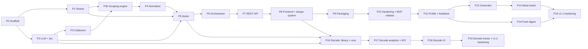

# 10 — Master Implementation & Testing Plan

**Single source of truth for build order, tasks, tests, gates and wiring.** One chain connects everything:

```
Requirement (FR / US)  →  Phase  →  Task  →  Test IDs  →  Health row (F / S)  →  Gate command
```

`tools/check_docs_wiring.py` verifies this chain across the docs. `npm run check:plan` verifies it against the code.

## 0. Document ownership

| Doc | Owns | Used for |
|-----|------|----------|
| 01 PRD | Requirements FR-1…48 (FR-49…59 are defined in 11), user stories US-1…10 | What and why |
| 02 TRD, 03 UI/UX, 04 App flow | Architecture, screens, flows | How it behaves |
| 05 Backend schema | Sheets tabs, SQLite DDL, zod types, REST API, env vars | Contracts |
| 06 Implementation plan | MVP task detail and acceptance wording | Detail only |
| 07 Testing plan | **Catalogue of test cases** (steps and expected results) | Detail only |
| 08 v1.1 pack, 09 Scrapling | Feature specs | Detail only |
| 11 Decode rewire + UI system | Jev correction (typed classifier), Format Decode, design system, FR-49…59, tests JEV, STY, DEC, W-20…23 | Detail only; wins on Jev roles and visual system |
| **10 (this file)** | **Phase order, tasks, test scheduling, wiring tests, health-board schedule, gates, schedule** | **Source of truth** |

Conflict rule: this file wins on order, gates, IDs and numbers. For behavior, schema wins over TRD, TRD over PRD, PRD over flow, flow over UI (as in the master prompt).

## 1. Wiring rules

1. Every **task** ends with `→` and at least one test ID (or the word `regression`).
2. Every **test ID** in the catalogue (07) or defined here (§3) is scheduled in exactly one phase, or listed as deferred.
3. A task may only point to tests scheduled in its own phase or earlier.
4. A **health row** (F/S) has a gate phase that is **at or after** the phase of every test it uses.
5. Every **FR and US** maps to phase(s), tests and health row(s) (§9).
6. `npm run verify` is built in **Phase 0** and grows each phase. Gate = all rows scheduled up to that phase are green.
7. Every phase ends with the same four commands (§10) and a git tag `phase-N`.
8. Every test title begins with its ID, for example `it('COL-08 isolates failing collector')`.

## 2. Phase map



| Phase | Name | Days | Cumulative |
|-------|------|------|-----------|
| P0 | Scaffold + verify skeleton | 1 | 1 |
| P1 | Google Sheets layer | 2 | 3 |
| P2 | LLM layer + Jev classifier | 2 | 5 |
| P3 | Collectors (API/RSS) | 2.5 | 7.5 |
| P3b | Scraping engine (Scrapling sidecar) | 2.5 | 10 |
| P4 | Normalize + dedupe | 1.5 | 11.5 |
| P5 | Sorter: classify, cluster, write, score | 4 | 15.5 |
| P6 | Orchestrator + scheduler | 2 | 17.5 |
| P7 | REST API | 1.5 | 19 |
| P8 | Frontend + design system | 5 | 24 |
| P9 | Packaging | 1 | 25 |
| P10 | Hardening + MVP release | 1 (+3 days soak wall time) | 26 |
| P11 | Profile, feedback, personalization | 2.5 | 28.5 |
| P12 | Content generator + angles | 3 | 31.5 |
| P13 | Ideas board | 2.5 | 34 |
| P14 | Push digest | 2 | 36 |
| P15 | v1.1 hardening | 1 | 37 |
| P16 | Decode: format library + runs | 2 | 39 |
| P17 | Decode: analytics, storage, API | 2 | 41 |
| P18 | Decode: UI | 3 | 44 |
| P19 | Decode extras + v1.2 hardening | 1.5 | 45.5 |

MVP ≈ **26 working days** (about 5 weeks). v1.1 adds ≈ **11 days**, v1.2 (Decode) adds ≈ **8.5 days**, total ≈ **45.5 days**. Earlier docs said 16–20, 19–23 or 24 days for the MVP; those sums are superseded.

Order is flexible after P10: P16 depends only on P2, P5 and P8, so Decode can run before P11–P15.

Optional parallel tracks: P1 ∥ P2 after P0. UI tokens and components (P8-T1, P8-T2) can start with a mocked API once P7 routes are fixed.

## 3. Test IDs defined in this file

Catalogue IDs (SET, COL, NRM, LLM, SHT, SRT, RUN, API, UI, SEC, NFR, PKG, PRF, FBK, GEN, ANG, IDEA, DIG, SCR) live in `07_TESTING_PLAN.md`. JEV, STY and DEC tests and the wiring tests W-20…W-23 are defined in `11_DECODE_REWIRE_AND_UI.md` §6 and §7. The following are defined here.

### 3.1 Infrastructure (INF)

| ID | Test |
|----|------|
| INF-01 | Config loader: defaults applied, bad env fails with one readable message listing every problem |
| INF-02 | Migrations apply on an empty DB and are idempotent; `schema_migrations` rows correct |
| INF-03 | Logger redacts keys, tokens, passwords and the service-account private key |
| INF-04 | Server boots on `127.0.0.1`; `/api/health` returns documented fields |
| INF-05 | `verify` runner executes registered checks, prints board, writes reports, exits 1 on failure, honors `--upto N` |
| INF-06 | `check:plan` fails on any unwired task, test, health row, FR or US |
| INF-07 | Test harness (fake LLM, fake Sheets, msw, factories) starts in under 2 s and leaves no open ports |

### 3.2 Wiring tests (W) — one per seam

| ID | Seam | Test |
|----|------|------|
| W-01 | Domain ⇄ Sheets | `RawItem` ⇄ `raw_trends` row round trip: all fields, nulls, JSON arrays, `source_label` |
| W-02 | Domain ⇄ Sheets | `SortedTopic` ⇄ `sorted_trends` row round trip incl. `is_latest`, `hidden` |
| W-03 | Collectors → pipeline | Every registered collector returns zod-valid drafts and stats; registry covers every `SourceKey` |
| W-04 | Scraping → pipeline | Items from sidecar (test site) are valid drafts with `source=recipe` and `source_label`, accepted by normalize |
| W-05 | Collect → normalize → store | Counts reconcile: collected − merged − seen = persisted in `items_run` |
| W-06 | Store → sorter → sheet | `items_run` pending → Jev (fake) → score → sorted rows; every evidence id exists in raw rows |
| W-07 | Whole pipeline | Fake run: raw rows = persisted items; sorted rows = API `/trends` total; digest and `runs_log` rows exist |
| W-08 | Resilience | Kill at every stage boundary; final state equals a clean run (row-level diff) |
| W-09 | Docs ⇄ API | Registered routes equal routes documented in 05 §4, 08 §7, 09 §7; each has request/response zod schema |
| W-10 | API ⇄ Web | Every call in `web/src/lib/api.ts` hits a registered route; shared zod types compile in server and web |
| W-11 | Browser E2E | Wizard → first run → Today → drawer evidence links match raw items → CSV export matches |
| W-12 | Live | Real Sheets, OmniRoute, Jev and sources end to end via `verify --mode live` |
| W-13 | Scoring | One scoring module feeds API `for_you_score` and digest ordering; feedback changes both |
| W-14 | Evidence → draft | Draft prompt contains the topic's evidence ids; stored `sources` ⊂ evidence; draft visible in UI |
| W-15 | Ideas → sheet | Idea change → SQLite → API → `content_ideas` event; rebuilding from the sheet log reproduces statuses |
| W-16 | Finalize → digest | Run finalize event → digest builder → fake channels; scheduled mode uses the same builder |
| W-17 | Settings → runtime | Changing Jev model, schedule, niches, creator profile hot-reloads into LLM client, scheduler, collectors, prompts without restart |
| W-18 | Env ⇄ config | Every env var in docs exists in the config schema with a default; every config key is documented in `.env.example` |
| W-19 | Migrations | Chain 001→005 applies in order on an empty DB; upgrading an older DB keeps data; sheet upgrades (`content_ideas`, `decode_results`) are idempotent |

### 3.3 Chaos drills (CH)

| ID | Drill |
|----|-------|
| CH-01 | Kill -9 during each stage, resume without duplicates |
| CH-02 | Network lost mid-collect |
| CH-03 | Sheets access revoked mid-run |
| CH-04 | OmniRoute stopped mid-sort |
| CH-05 | Jev returns garbage for every batch |
| CH-06 | Sheet near the cell cap |
| CH-07 | Disk full for SQLite |
| CH-08 | Clock or timezone jump |
| CH-09 | Corrupt `state.db`, then `rebuild-state` |
| CH-10 | Two app instances on one DB |
| CH-11 | Kill app while saving idea edits |
| CH-12 | Telegram API down for a day |
| CH-13 | Jev copies evidence verbatim into a draft |
| CH-14 | 500 feedback clicks in a minute |
| CH-15 | Browser hangs mid-fetch |
| CH-16 | Target site changes layout overnight |
| CH-17 | Site starts returning 429 |
| CH-18 | User enters an internal URL as a recipe |

## 4. Phase plans

Each phase lists tasks (`→` tests proving them), the tests to write first, wiring tests, health rows turned green, and the gate.

### Phase 0 — Scaffold + verify skeleton (1 d)
**Depends on:** none
**Implements:** TRD §2–3, schema §2 (001), §5, testing plan §2.1
- [ ] P0-T1 Repo, workspaces (`server`, `web`, `scrapling-service`), TypeScript ESM, eslint, prettier, vitest, CI skeleton → INF-04
- [ ] P0-T2 Config loader (zod) covering **every** env var in 05 §5, 08 §5.3, 09 §7, with defaults and readable errors → INF-01, W-18
- [ ] P0-T3 SQLite bootstrap, migration runner, `001_init.sql` → INF-02
- [ ] P0-T4 Logger with redaction → INF-03
- [ ] P0-T5 Fastify boot, `/api/health`, loopback bind → INF-04
- [ ] P0-T6 `verify` runner and registry (`verify/registry.ts`: id, phase, tests[], fr[]) → INF-05
- [ ] P0-T7 `check:plan` script (reads this file and test titles) → INF-06
- [ ] P0-T8 Test harness shells: fake LLM server, `SheetsClient` interface + fake, msw, item factories → INF-07
- [ ] P0-T9 `.env.example` (complete), `DECISIONS.md`, `THIRD_PARTY.md` → W-18

**Tests:** INF-01…07
**Wiring tests:** W-18
**Health rows:** none yet (runner works with zero rows)
**Gate:** §10 commands with N=0; CI green on empty app.

### Phase 1 — Google Sheets layer (2 d)
**Depends on:** P0
**Implements:** TRD §9, schema §1, FR-9, FR-10, FR-11, FR-18 (part)
- [ ] P1-T1 Service-account auth, `SheetsClient` real implementation → SHT-01
- [ ] P1-T2 `sheets/schema.ts`: single registry of tabs and columns (incl. `raw_trends` column S `source_label`); init, tests and UI links all read from it → SHT-01, SHT-02
- [ ] P1-T3 Repository: `appendRaw`, `appendSorted`, `appendDigest`, `appendRunLog`, reads, `markLatest` → SHT-03, SHT-08, SHT-16
- [ ] P1-T4 Single-writer queue: batching ≤ 500, min gap, backoff, 429 and 403 mapping → SHT-03, SHT-04, SHT-05, SHT-15
- [ ] P1-T5 Row ⇄ object mappers with zod, bad-row skip, field caps → SHT-07, SHT-14, W-01, W-02
- [ ] P1-T6 Read cache with TTL and invalidation → SHT-10
- [ ] P1-T7 Auto re-init when a tab is missing → SHT-06
- [ ] P1-T8 `hidden` flag respected on reads → SHT-09
- [ ] P1-T9 Retention (archive/delete) and `rebuild-state` script → SHT-11, SHT-12, SHT-13

**Tests:** SHT-01…16
**Wiring tests:** W-01, W-02
**Health rows:** F02, F15
**Gate:** §10 with N=1. Note: `SHT-01` asserts the tab list taken from `schema.ts`, never a hard-coded count (v1.1 adds `content_ideas`).

### Phase 2 — LLM layer and Jev classifier (2 d)
**Depends on:** P0
**Implements:** TRD §5 (as amended by 11 §1), FR-7 (extractor), FR-14 (repair for writer output), FR-49, FR-50, FR-51
- [ ] P2-T1 OpenAI-compatible client (OmniRoute): timeout, retry, backoff, `Retry-After` → LLM-08, LLM-09, LLM-10, LLM-14
- [ ] P2-T2 `json()` helper for writer and extractor: fence stripping, trailing text, zod validation, repair call, error types → LLM-04, LLM-05, LLM-06, LLM-07
- [ ] P2-T3 Model resolution for extractor, writer and fallback classifier from config, clear error when unset → LLM-13
- [ ] P2-T4 `llm_calls` logging with tokens and cost, log hygiene → LLM-11, LLM-12
- [ ] P2-T5 Extractor function (messy text → structured fields, `is_article` gate) → LLM-01, LLM-02
- [ ] P2-T6 Jev SystemOne client: `choice` and `noul` questions, typed parsing, key redaction, state cap 4,000 chars → JEV-01, JEV-02, JEV-03, JEV-11
- [ ] P2-T7 Jev error handling: missing answer, out-of-criteria choice coerced to `none`, 429 and 5xx backoff → JEV-04, JEV-05, JEV-06
- [ ] P2-T8 Concurrency cap and `LabelCache` interface with in-memory implementation (SQLite version arrives in P5) → JEV-08, JEV-09
- [ ] P2-T9 Cost ledger and per-run budget → JEV-10
- [ ] P2-T10 `Classifier` interface and OmniRoute fallback classifier, timeout fallback → JEV-07, JEV-12
- [ ] P2-T11 Injection resistance of classification state → JEV-13
- [ ] P2-T12 Fake OmniRoute server (12 modes) and fake Jev SystemOne server → LLM-04
- [ ] P2-T13 `testOmniroute()` and `testJev()` helpers (sample classification; routes exposed in P7) → JEV-01

**Tests:** LLM-01, LLM-02, LLM-04…14, JEV-01…13
**Wiring tests:** none
**Health rows:** J01, J02
**Gate:** §10 with N=2.

### Phase 3 — Collectors: APIs and RSS (2.5 d)
**Depends on:** P0, P2
**Implements:** TRD §4, FR-1 (6 sources), FR-2, FR-3, FR-5 (collection side)
- [ ] P3-T1 Native HTTP client: User-Agent, per-domain limiter, retry, ETag cache, robots check → COL-09
- [ ] P3-T2 `Collector` interface, registry, `npm run collect -- --source x` → W-03
- [ ] P3-T3 `hackernews` → COL-01
- [ ] P3-T4 `reddit` (OAuth optional) → COL-02
- [ ] P3-T5 `google_trends` → COL-03
- [ ] P3-T6 `github` → COL-04
- [ ] P3-T7 `wikipedia` → COL-05
- [ ] P3-T8 `rss` with conditional requests → COL-06
- [ ] P3-T9 Failure isolation and per-source stats → COL-08
- [ ] P3-T10 Niches, item limit, missing-key skip → COL-12, COL-13, COL-14
- [ ] P3-T11 Real recorded fixtures and `fixtures:refresh` → COL-01

**Tests:** COL-01…06, COL-08, COL-09, COL-12, COL-13, COL-14
**Wiring tests:** W-03
**Health rows:** F03, F04, F05, F06, F07, F08
**Gate:** §10 with N=3. `webpage` and `recipe` are not in this phase.
**Deferred (not scheduled):** COL-15 (YouTube, Product Hunt, Dev.to collectors, backlog)

### Phase 3b — Scraping engine (2.5 d)
**Depends on:** P1, P2, P3
**Implements:** `09_SCRAPLING_INTEGRATION.md`, FR-1 (webpage, recipe), FR-4, FR-7, FR-47, FR-48
- [ ] P3b-T1 Sidecar skeleton: `/health`, token auth, config, Dockerfile → SCR-01
- [ ] P3b-T2 Guards: SSRF resolver, robots cache, per-domain limiter, size and type caps, block detection → SCR-04, SCR-05, SCR-10, SCR-11, SCR-14, COL-10, COL-11
- [ ] P3b-T3 `/fetch`: http, browser, `auto` escalation, domain hints, timeouts → SCR-02, SCR-03, SCR-06
- [ ] P3b-T4 Recipes: model, transforms, `/recipe/run`, `/recipe/test`, adaptive profile and healing, health states → SCR-07, SCR-08, SCR-09, SCR-16
- [ ] P3b-T5 Node `ScraplingClient`, supervisor, circuit breaker, native fallback → SCR-12, SCR-13
- [ ] P3b-T6 `webpage` collector via sidecar, `recipe` collector → COL-07, LLM-03, W-04
- [ ] P3b-T7 Migration `002_scraping.sql`, recipes API (CRUD, test), error codes, zod ⇄ pydantic parity → SCR-15, SCR-21
- [ ] P3b-T8 `source_label` end to end, log hygiene, stealth exclusion (rejected mode, CI grep) → SCR-22, SCR-19, SCR-18
- [ ] P3b-T9 `npm run setup:scraper`, local test site, live checks → SCR-23, SCR-24

**Tests:** COL-07, COL-10, COL-11, LLM-03, SCR-01…16, SCR-18, SCR-19, SCR-21…24
**Wiring tests:** W-04
**Health rows:** F09, F11, S01, S02, S03, S04, S05
**Gate:** §10 with N=3b; live check returns ≥ 10 items from a real public page in `http` and `browser` modes.
**Notes:** the Recipes **UI** is built in P8 (SCR-17), so S06 turns green at P8. Doctor integration is completed in P9 (SCR-20). Deferred: SCR-25 (Jev selector suggestion, optional).

### Phase 4 — Normalize and dedupe (1.5 d)
**Depends on:** P3, P3b
**Implements:** TRD §6 stages 2–4, FR-6, FR-8, FR-2 (cleaning)
- [ ] P4-T1 URL canonicalization and content hash → NRM-01, NRM-02
- [ ] P4-T2 Trigram near-duplicate merge, `merged_sources` → NRM-03
- [ ] P4-T3 Cross-day dedupe API on `seen_items` (written by P6 after sheet success) → NRM-04, NRM-05
- [ ] P4-T4 `engagement_norm`: percentile and position fallback → NRM-06, NRM-07
- [ ] P4-T5 Sanitize, language, dates → NRM-08, NRM-10
- [ ] P4-T6 `items_run` working set; reconcile counts → W-05

**Tests:** NRM-01…08, NRM-10
**Wiring tests:** W-05
**Health rows:** F13, F14
**Gate:** §10 with N=4.

### Phase 5 — Sorter: classify, assign, cluster, score, write (4 d; Doc 19 order: score before write, top `TOP_PER_CATEGORY` per category)
**Depends on:** P1, P2, P4
**Implements:** TRD §6 stages 6–9 (as amended by 11 §1.3), §7, FR-5 (sorting side), FR-12…15, FR-49, FR-51
- [ ] P5-T1 Migration `003_labels.sql`, SQLite `LabelCache`, question set v1 (category, quality, niche_fit, novelty, sentiment) → W-20
- [ ] P5-T2 Classify stage: cache, budget stop, fallback marking, coercion of bad answers → SRT-04, JEV-14
- [ ] P5-T3 Quality filter and discarded items → SRT-13
- [ ] P5-T4 Clustering: trigram similarity, optional embeddings, `same_story` check for borderline pairs → SRT-03, SRT-09, JEV-15
- [ ] P5-T5 Aggregation: category vote, relevance, novelty, sentiment per cluster → SRT-01
- [ ] P5-T6 Momentum rules in code → SRT-07
- [ ] P5-T7 Writer prompt v1 and stage: JSON, id verification, repair, split, `write_failed` → SRT-02, SRT-08, SRT-12
- [ ] P5-T8 `score.ts`: formula, weights, determinism → SRT-05, SRT-06, SRT-14
- [ ] P5-T9 Daily digest by writer model → SRT-10
- [ ] P5-T10 Niche-aware relevance (`niche_fit` only when niches set) → SRT-11
- [ ] P5-T11 Persist sorted rows, `is_latest` flip, model and prompt versions, cache invalidation on model change → SRT-15
- [ ] P5-T12 Live quality check on real items → SRT-16
- [ ] P5-T13 Items → sorter input → sheet seam → W-06

**Tests:** SRT-01…16, JEV-14, JEV-15
**Wiring tests:** W-06, W-20
**Health rows:** F12, F16, F17, F18, F19, F20
**Gate:** §10 with N=5; JEV-14 needs a real key (live), all else runs on fakes.

### Phase 6 — Orchestrator and scheduler (2 d)
**Depends on:** P1, P3, P3b, P4, P5
**Implements:** TRD §6, §10, flow doc §2–3, §6, §8, FR-3, FR-10, FR-17 (events), FR-20…22
- [ ] P6-T1 Stage runner with checkpoints in `run_stages` → RUN-01, RUN-02
- [ ] P6-T2 Status semantics: success, partial, failed → RUN-03, RUN-04
- [ ] P6-T3 Resume, retry stage, re-sort only, single-source run → RUN-05, RUN-06, RUN-11, RUN-13, W-08
- [ ] P6-T4 Lock table with heartbeat and stale recovery → RUN-07, RUN-08
- [ ] P6-T5 Cron, catch-up, live reschedule → RUN-09, RUN-10, RUN-16
- [ ] P6-T6 Event bus with replay of last 50 events (SSE source) → RUN-12
- [ ] P6-T7 `seen_items` written only after sheet success → NRM-09
- [ ] P6-T8 `runs_log` row, token totals, retention job after finalize → RUN-14, RUN-15
- [ ] P6-T9 Full fake pipeline → W-07

**Tests:** RUN-01…16, NRM-09
**Wiring tests:** W-07, W-08
**Health rows:** F10, F21, F22, F23, F24, F25, F37
**Gate:** §10 with N=6.

### Phase 7 — REST API (1.5 d)
**Depends on:** P1, P6
**Implements:** schema §4, 08 §7 (later phases), 09 §7, FR-18, FR-19
- [ ] P7-T1 Read routes: health, trends, topic detail, digest, raw, dates → API-01, API-02, API-03, API-04, API-05, API-06
- [ ] P7-T2 Sources, runs, retry, settings routes → API-07, API-08, API-09, API-10, API-11
- [ ] P7-T3 Setup test routes, sheets init, sync, link → API-12, API-13
- [ ] P7-T4 CSV and Markdown exports → API-14
- [ ] P7-T5 Error envelope and codes → API-15
- [ ] P7-T6 SSE route, optional password, loopback rules → API-16, SEC-01, SEC-02, SEC-03
- [ ] P7-T7 CORS, secret masking, path safety, env-over-settings precedence → SEC-04, SEC-06, SEC-11, SET-11
- [ ] P7-T8 Route parity against docs → W-09

**Tests:** API-01…16, SEC-01…04, SEC-06, SEC-11, SET-11
**Wiring tests:** W-09
**Health rows:** F33, F35, F36
**Gate:** §10 with N=7.

### Phase 8 — Frontend and design system (5 d)
**Depends on:** P7
**Implements:** `03_UI_UX_DESIGN.md` structure, `11_DECODE_REWIRE_AND_UI.md` §4 visual system, FR-16, FR-17, FR-52, FR-47 (Recipes tab), US-1…7
- [ ] P8-T1 Design tokens in one source file, self-hosted Geist fonts, global styles → STY-01, STY-04, W-23
- [ ] P8-T2 Components: Bar, Eyebrow, Hero, BlockGrid, FlowStrip, Steps, Pill, Tip, CodePanel, Table, Figure, Button; contrast and reduced-motion rules → STY-03, STY-05, UI-01
- [ ] P8-T3 Typed API client from shared zod → W-10
- [ ] P8-T4 Today page per 11 §4.4: hero blocks, flow strip, filters, topic rows, URL state → UI-02, UI-03
- [ ] P8-T5 Run now, status pill, SSE progress → UI-04
- [ ] P8-T6 Side panel for a topic, copy actions, open-in-Sheets → UI-05, UI-06, UI-16
- [ ] P8-T7 Explore and Raw Data → UI-07, UI-08
- [ ] P8-T8 Sources page and **Recipes tab** (editor, Test, health chips) → UI-09, SCR-17
- [ ] P8-T9 Runs page → UI-10
- [ ] P8-T10 Settings with Test buttons and hot reload → UI-11, W-17
- [ ] P8-T11 States, shortcuts, sheet-hidden rows, accessibility, responsive, XSS safety → UI-12, UI-13, UI-14, UI-15, UI-17, UI-18
- [ ] P8-T12 Setup wizard in the `Steps` pattern, 5 steps with resume → SET-01…09
- [ ] P8-T13 Visual snapshots at 375, 800 and 1280 px → STY-02
- [ ] P8-T14 Writer output → topic row → API → UI list seam → W-21
- [ ] P8-T15 Browser E2E → W-11

**Tests:** UI-01…18, SET-01…09, SCR-17, STY-01…05
**Wiring tests:** W-10, W-11, W-17, W-21, W-23
**Health rows:** F01, F26, F27, F28, F29, F30, F31, F32, F34, S06, U01
**Gate:** §10 with N=8.

### Phase 9 — Packaging (1 d)
**Depends on:** P8
**Implements:** TRD §15, US-1, goal G3
- [ ] P9-T1 `npm run setup` interactive CLI → SET-10
- [ ] P9-T2 `npm run doctor` full diagnostics (env, Sheets, OmniRoute, Jev, sources, scraper, browsers) → PKG-04, SCR-20
- [ ] P9-T3 Dockerfile and compose with the `scrapling` service → PKG-03
- [ ] P9-T4 `build` and `start` → PKG-06
- [ ] P9-T5 README quick start, service-account walkthrough, OmniRoute notes → PKG-01, PKG-05
- [ ] P9-T6 OS, Node and browser matrix → PKG-02, PKG-07

**Tests:** PKG-01…07, SET-10, SCR-20
**Wiring tests:** none
**Health rows:** F39, F40
**Gate:** §10 with N=9; PKG-01 under 10 minutes on a clean machine.

### Phase 10 — Hardening and MVP release (1 d, plus soak)
**Depends on:** P9
**Implements:** NFRs, security review, release criteria
- [ ] P10-T1 Security review: log grep, browser storage, hostile corpus, outbound inspection, audit → SEC-05, SEC-07, SEC-08, SEC-09, SEC-10
- [ ] P10-T2 Performance and size projection → NFR-01, NFR-02, NFR-04, NFR-05, NFR-06, NFR-07, NFR-08
- [ ] P10-T3 Chaos drills for the MVP and the scraper → CH-01…10, CH-15…18
- [ ] P10-T4 Live verify on real services → W-12
- [ ] P10-T5 Start 72-hour soak at the beginning of the phase → NFR-03
- [ ] P10-T6 Fix top 5 papercuts, tag `v1.0.0` → regression

**Tests:** SEC-05, SEC-07…10, NFR-01…08, CH-01…10, CH-15…18
**Wiring tests:** W-12
**Health rows:** F38
**Gate:** §11 MVP release gate. `npm run verify` = 49/49.

### Phase 11 — Profile, feedback, personalization (2.5 d)
**Depends on:** P5, P7, P8, P10
**Implements:** `08_V1_1_OWN_CONTENT_PACK.md` §4.1, FR-23…28
- [ ] P11-T1 Migration `004_creator_pack.sql` (all four v1.1 tables) → W-19
- [ ] P11-T2 Creator profile settings and validation; Settings tabs Creator and Personalization → PRF-01, PRF-03
- [ ] P11-T3 Feedback events API with de-dupe → FBK-01, FBK-02
- [ ] P11-T4 Hide handling (app plus sheet flag), `include_hidden`, `hide_used` → FBK-03, FBK-04
- [ ] P11-T5 Personal-fit score `P`, `for_you_score`, cold start, niche seeding, in the shared scoring module → FBK-05, FBK-06, FBK-07, FBK-09, PRF-02
- [ ] P11-T6 Personalization summary and reset → FBK-08
- [ ] P11-T7 UI: feedback buttons, Trending / For you toggle, fit explanation in drawer → UI-19
- [ ] P11-T8 Scoring consistency between API and digest → W-13

**Tests:** PRF-01…03, FBK-01…09, UI-19
**Wiring tests:** W-13, W-19
**Health rows:** F42, F43, F44
**Gate:** §10 with N=11.

### Phase 12 — Content generator and angles (3 d)
**Depends on:** P11
**Implements:** 08 §4.2, §6, FR-29…35
- [ ] P12-T1 Draft prompt v1 with profile injection → PRF-04, GEN-08
- [ ] P12-T2 Generation service: six formats, variants, evidence loader → GEN-01, GEN-07, GEN-11, GEN-13
- [ ] P12-T3 Guards: length, numbers, sources, overlap → GEN-02, GEN-03, GEN-04, GEN-05
- [ ] P12-T4 Repair, failure, injection resilience → GEN-06, GEN-12
- [ ] P12-T5 Drafts API: edit, regenerate, export → GEN-09, GEN-10
- [ ] P12-T6 More angles endpoint → ANG-01, ANG-02
- [ ] P12-T7 Generator panel and flags; "Save as idea" stays hidden until P13 → UI-20, UI-21, UI-22
- [ ] P12-T8 Log hygiene for voice samples and prompts → SEC-13
- [ ] P12-T9 Language handling, live check → GEN-14
- [ ] P12-T10 Evidence → draft → UI seam → W-14

**Tests:** PRF-04, GEN-01…14, ANG-01, ANG-02, UI-20…22, SEC-13
**Wiring tests:** W-14
**Health rows:** F41, F45, F46, F47
**Gate:** §10 with N=12; five real drafts reviewed by hand.

### Phase 13 — Ideas board (2.5 d)
**Depends on:** P12
**Implements:** 08 §4.3, FR-36…40
- [ ] P13-T1 `content_ideas` tab added to `schema.ts` and `init`; sheet upgrade idempotent → W-15
- [ ] P13-T2 Ideas API: create, patch, status moves, duplicate guard → IDEA-01, IDEA-02, IDEA-04, IDEA-05, IDEA-10
- [ ] P13-T3 Ordering, archive, CSV export → IDEA-03, IDEA-08
- [ ] P13-T4 Event log append with queued retry → IDEA-06, IDEA-07
- [ ] P13-T5 Kanban UI with keyboard moves → IDEA-09, UI-23
- [ ] P13-T6 "Save as idea" from angles and drafts; enable the button in the generator → ANG-03

**Tests:** IDEA-01…10, ANG-03, UI-23
**Wiring tests:** W-15
**Health rows:** F48, F49, F50
**Gate:** §10 with N=13.

### Phase 14 — Push digest (2 d)
**Depends on:** P11, P6
**Implements:** 08 §4.4, FR-41…46
- [ ] P14-T1 Message builder and preview → DIG-01, DIG-11, DIG-12, DIG-13
- [ ] P14-T2 Telegram, Slack and email senders → DIG-02, DIG-03, DIG-04
- [ ] P14-T3 `digest_deliveries`, idempotency, retries, force resend → DIG-05, DIG-06
- [ ] P14-T4 Modes `after_run` and `scheduled`, failure notice, partial-run note → DIG-07, DIG-08, DIG-09
- [ ] P14-T5 Test endpoints and secret handling → DIG-10, SEC-12
- [ ] P14-T6 Settings → Notifications tab, empty and failed states → UI-24, UI-25
- [ ] P14-T7 Finalize event → builder → senders seam → W-16

**Tests:** DIG-01…13, UI-24, UI-25, SEC-12
**Wiring tests:** W-16
**Health rows:** F51, F52, F53, F54
**Gate:** §10 with N=14; a real Telegram or Slack message received.

### Phase 15 — v1.1 hardening (1 d)
**Depends on:** P13, P14
**Implements:** 08 §10 phase 15
- [ ] P15-T1 Chaos drills for ideas, Telegram outage, copy-guard and feedback load → CH-11…14
- [ ] P15-T2 `npm run backup` and restore check → CH-11
- [ ] P15-T3 Full regression, fake and live, 63/63 → regression
- [ ] P15-T4 Three days of real use, docs refresh, tag `v1.1.0` → regression

**Tests:** CH-11…14
**Wiring tests:** none
**Health rows:** none new (all 60 green)
**Gate:** §11 v1.1 release gate.

### Phase 16 — Decode: format library and runs (2 d)
**Depends on:** P2, P5, P8
**Implements:** `11_DECODE_REWIRE_AND_UI.md` §3, FR-53, FR-54, FR-55
- [ ] P16-T1 Migration `005_decode.sql`, format library service and API, `none` added automatically → DEC-01
- [ ] P16-T2 Collection builder: sources, date range, min engagement, keyword, item cap → DEC-02
- [ ] P16-T3 CSV import validation and staging → DEC-03
- [ ] P16-T4 Cost estimate and confirmation above the cap → DEC-04
- [ ] P16-T5 Decode run engine: Jev `format` choice plus `on_topic` filter, progress events → DEC-05
- [ ] P16-T6 Cancel, resume, cached labels → DEC-09

**Tests:** DEC-01…05, DEC-09
**Wiring tests:** none
**Health rows:** D01, D02
**Gate:** §10 with N=16.

### Phase 17 — Decode: analytics, storage, API (2 d)
**Depends on:** P16
**Implements:** 11 §3.2, §3.5, §3.6, FR-56, FR-58
- [ ] P17-T1 Metric-kind rule and normalization → DEC-08
- [ ] P17-T2 Medians, overall median, multiples → DEC-06
- [ ] P17-T3 `too_small` rule → DEC-07
- [ ] P17-T4 Persist `decode_runs` and `decode_items`, append `decode_results` tab, reopen runs → DEC-10
- [ ] P17-T5 Remaining routes with zod, error codes, route parity → DEC-11
- [ ] P17-T6 CSV and Markdown exports → DEC-16
- [ ] P17-T7 Run → analytics → API → export consistency → W-22

**Tests:** DEC-06, DEC-07, DEC-08, DEC-10, DEC-11, DEC-16
**Wiring tests:** W-22
**Health rows:** D03, D04
**Gate:** §10 with N=17.

### Phase 18 — Decode: UI (3 d)
**Depends on:** P17
**Implements:** 11 §3.1, §4.4, FR-57
- [ ] P18-T1 Scatter figure: SVG, log axes, legend keys, dots → DEC-12
- [ ] P18-T2 Format chips that highlight a format and dot selection → DEC-12
- [ ] P18-T3 Side panel: hook, numbers, excerpt, link → DEC-13
- [ ] P18-T4 Ranking table with winner marker and too-small styling → DEC-14
- [ ] P18-T5 Replay animation with reduced-motion guard → DEC-15
- [ ] P18-T6 Library editor in the `Steps` pattern, collection and CSV screens, cost dialog, run progress → DEC-12

**Tests:** DEC-12…15
**Wiring tests:** none
**Health rows:** D05
**Gate:** §10 with N=18; snapshots for Decode pages added to STY-02.

### Phase 19 — Decode extras and v1.2 hardening (1.5 d)
**Depends on:** P18
**Implements:** 11 §3.2 (thumbnails), FR-59, release gate
- [ ] P19-T1 Optional thumbnails through a safe image proxy with cache → DEC-18
- [ ] P19-T2 Live decode of 100 real items → DEC-17
- [ ] P19-T3 Jev-down-mid-run drill → DEC-19
- [ ] P19-T4 Full regression 69/69, docs refresh, tag `v1.2.0` → regression

**Tests:** DEC-17, DEC-18, DEC-19
**Wiring tests:** none
**Health rows:** D06
**Gate:** §11 v1.2 release gate.

## 5. Health board schedule

`npm run verify` registers every row below with its gate phase. `--upto N` runs rows with gate ≤ N.

| Row | Gate | Feature |
|-----|------|---------|
| F02 | P1 | Sheet tabs auto-created |
| F15 | P1 | Raw rows written |
| J01 | P2 | Jev typed classification, cache, cost ledger |
| J02 | P2 | Fallback classifier |
| F03 | P3 | Hacker News |
| F04 | P3 | Reddit |
| F05 | P3 | Google Trends |
| F06 | P3 | GitHub |
| F07 | P3 | Wikipedia |
| F08 | P3 | RSS |
| F09 | P3b | Web page + extraction |
| F11 | P3b | Robots and rate limits |
| S01 | P3b | Sidecar healthy and supervised |
| S02 | P3b | HTTP and browser fetch |
| S03 | P3b | Politeness, blocked handling, no stealth |
| S04 | P3b | SSRF protection |
| S05 | P3b | Recipes and adaptive healing |
| F13 | P4 | Canonicalize and dedupe |
| F14 | P4 | Engagement normalization |
| F12 | P5 | Niche keywords |
| F16 | P5 | Jev clustering |
| F17 | P5 | Score and rank |
| F18 | P5 | Bad Jev output handled |
| F19 | P5 | Daily digest |
| F20 | P5 | Sorted rows and latest flag |
| F10 | P6 | Source failure isolation |
| F21 | P6 | Cron |
| F22 | P6 | Missed-run catch-up |
| F23 | P6 | Single run lock |
| F24 | P6 | Crash resume |
| F25 | P6 | Re-sort and retry |
| F37 | P6 | Retention |
| F33 | P7 | Cache and Sync |
| F35 | P7 | Exports |
| F36 | P7 | Localhost bind and password |
| F01 | P8 | Setup wizard |
| F26 | P8 | Live progress |
| F27 | P8 | Today page |
| F28 | P8 | Topic drawer |
| F29 | P8 | Explore and Raw Data |
| F30 | P8 | Sources page |
| F31 | P8 | Runs page |
| F32 | P8 | Settings |
| F34 | P8 | Open-in-Sheets links |
| S06 | P8 | Recipes UI, API and native fallback |
| U01 | P8 | Design system conformance |
| F39 | P9 | Doctor and setup CLI |
| F40 | P9 | Clean install ≤ 10 min |
| F38 | P10 | Secrets never leaked |
| F42 | P11 | Feedback buttons |
| F43 | P11 | For-you ranking |
| F44 | P11 | Personalization summary and reset |
| F41 | P12 | Creator profile applied |
| F45 | P12 | Drafts in six formats |
| F46 | P12 | Draft guards |
| F47 | P12 | Draft edit, regenerate, copy, export |
| F48 | P13 | More angles |
| F49 | P13 | Ideas board |
| F50 | P13 | Idea event log and CSV |
| F51 | P14 | Telegram digest |
| F52 | P14 | Slack digest |
| F53 | P14 | Email digest |
| F54 | P14 | Digest idempotent and isolated |
| D01 | P16 | Format library, collection, CSV import |
| D02 | P16 | Decode classification, cost control, resume |
| D03 | P17 | Decode analytics (medians, multiples, too-small) |
| D04 | P17 | Decode persistence, API, exports |
| D05 | P18 | Decode chart, chips, panel, table |
| D06 | P19 | Thumbnails, live decode, Jev-down drill |

Cumulative green rows at each gate: P1 2 · P2 4 · P3 10 · P3b 17 · P4 19 · P5 25 · P6 32 · P7 35 · P8 46 · P9 48 · **P10 49 (MVP)** · P11 52 · P12 56 · P13 59 · **P14 63 (v1.1)** · P16 65 · P17 67 · P18 68 · **P19 69 (v1.2)**.

## 6. Test infrastructure build order

| Asset | Built in | First used by | Extended in |
|-------|----------|---------------|-------------|
| `verify` runner, `check:plan` | P0 | every gate | every phase adds rows |
| Fake `SheetsClient` | P0 shell, P1 full | P1, P4, P5, P6 | P13 (`content_ideas`) |
| Fake LLM server (12 modes) | P0 shell, P2 full | P2, P5 | P12 (drafts), P14 none |
| Fake Jev SystemOne server | P2 | P2, P5 | P16 (decode) |
| Design tokens + Playwright snapshots | P8 | P8 | P18 (decode pages) |
| Source fixtures | P3 | P3 | P3b (test site) |
| Local test site + sidecar tests | P3b | P3b | P10 (chaos) |
| Item factories, golden files | P0, P5 | P4, P5 | P11 (feedback) |
| Hostile corpus | P5 | P5 | P8 (UI), P12 (drafts), P10 |
| Fake channels (Telegram, Slack, SMTP) | P14 | P14 | P15 |
| Playwright E2E | P8 | P8 | P11–P14 smoke additions |

## 7. Data wiring

### 7.1 SQLite migrations

| Migration | Phase | Tables |
|-----------|-------|--------|
| `001_init.sql` | P0 | `schema_migrations`, `settings`, `sources`, `runs`, `run_stages`, `run_source_stats`, `items_run`, `seen_items`, `llm_calls`, `locks`, `http_cache` |
| `002_scraping.sql` | P3b | `scrape_recipes`, `scrape_domain_hints` |
| `003_labels.sql` | P5 | `item_labels` (Jev answers, cache key) |
| `004_creator_pack.sql` | P11 | `topic_feedback`, `ideas`, `drafts`, `digest_deliveries` (created together because `drafts.idea_id` references `ideas`; unused until P12–P14) |
| `005_decode.sql` | P16 | `format_libraries`, `decode_runs`, `decode_items` |

### 7.2 Google Sheet tabs

| Tab | Phase | Notes |
|-----|-------|-------|
| `raw_trends` | P1 | Includes column S `source_label` from the start |
| `sorted_trends`, `daily_digest`, `runs_log` | P1 | Used from P5 and P6 |
| `archive_YYYY_MM` | P1 | Created by retention |
| `content_ideas` | P13 | Added to `schema.ts`; `init` upgrades existing sheets |
| `decode_results` | P17 | Decode results, append-only |

### 7.3 API groups: owner → consumer

| API group | Built | Consumed by UI |
|-----------|-------|----------------|
| Health | P0 | TopBar status (P8) |
| Trends, topic, digest, raw, dates | P7 | Today, Explore, Raw Data (P8) |
| Sources, settings, setup tests, sheets | P7 | Sources, Settings, Wizard (P8) |
| Runs, retry, SSE | P6 logic, P7 routes | Runs page, Run now (P8) |
| Exports | P7 | Today, Raw Data (P8) |
| Scraper health, recipes | P3b | Recipes tab (P8) |
| Feedback, personalization | P11 | Cards, drawer, Settings (P11) |
| Drafts, angles | P12 | Generator panel (P12) |
| Ideas | P13 | Ideas page (P13) |
| Digest preview, send, deliveries, notify tests | P14 | Notifications tab (P14) |
| Jev health | P7 | Settings → Connections (P8) |
| Format libraries, decode runs, exports | P16–P17 | Decode pages (P18) |

## 8. Config wiring (env → module → phase → tests)

| Env group | Module | Phase | Proven by |
|-----------|--------|-------|-----------|
| `PORT`, `HOST`, `TZ`, `DASHBOARD_PASSWORD`, `LOG_*` | server, logger, auth | P0, P7 | INF-01, INF-03, SEC-01, SEC-02, SEC-03 |
| `GOOGLE_*`, `SHEET_CACHE_TTL_S` | sheets | P1 | SHT-01, SHT-10 |
| `OMNIROUTE_*`, `LLM_*` | llm (extractor, writer, fallback) | P2 | LLM-13, LLM-14 |
| `JEV_*` | jev client | P2 | JEV-03, JEV-09, JEV-10 |
| `QUALITY_MIN`, `OMNIROUTE_WRITER_MODEL` | sorter | P5 | SRT-13, SRT-02 |
| `DECODE_*` | decode | P16 | DEC-02, DEC-04 |
| `TRENDS_GEO`, `NICHES`, `MAX_ITEMS_PER_SOURCE`, `USER_AGENT`, source keys | collectors | P3 | COL-03, COL-11, COL-12, COL-13, COL-14 |
| `SCRAPLING_*` | scraper client and sidecar | P3b | SCR-01…16 |
| `DEDUPE_DAYS` | dedupe | P4 | NRM-04 |
 | `SORT_BATCH_SIZE`, `TOP_PER_CATEGORY` (was `TOP_N`), score weights | sorter | P5 | SRT-01, SRT-06 |
| `SCHEDULE_CRON`, `RUN_MISSED_ON_START`, `AUTO_RESUME` | scheduler | P6 | RUN-09, RUN-10, RUN-08 |
| `RETENTION_*` | retention | P1, P6 | SHT-11, SHT-12, RUN-15 |
| `PERSONALIZATION` | scoring | P11 | FBK-09 |
| `DRAFT_MAX_VARIANTS` | generator | P12 | GEN-07 |
| `DIGEST_*`, `DASHBOARD_PUBLIC_URL`, `TELEGRAM_*`, `SLACK_*`, `SMTP_*` | digest | P14 | DIG-02…10 |

`ENABLE_PLAYWRIGHT` is removed; `SCRAPLING_ENABLED` replaces it. W-18 fails if code and `.env.example` drift apart.

## 9. Traceability

### 9.1 Requirements

| Req | Phase | Tests | Health |
|-----|-------|-------|--------|
| FR-1 | P3, P3b | COL-01…07 | F03…F09 |
| FR-2 | P3 | COL-01…07, NRM-08 | F03…F09 |
| FR-3 | P3, P6 | COL-08, COL-09, RUN-03 | F10 |
| FR-4 | P3b | COL-10, COL-11 | F11, S03 |
| FR-5 | P3, P5 | COL-12, SRT-11 | F12 |
| FR-6 | P4, P6 | NRM-01…05, NRM-09 | F13 |
| FR-7 | P2, P3b | LLM-01…03 | F09 |
| FR-8 | P4 | NRM-06, NRM-07 | F14 |
| FR-9 | P1 | SHT-01, SHT-02, SHT-06 | F02 |
| FR-10 | P1, P6 | SHT-11, SHT-12, SHT-16, RUN-15 | F15, F37 |
| FR-11 | P1 | SHT-03, SHT-04, SHT-15 | F15 |
| FR-12 | P5 | SRT-01…04, SRT-13, SRT-15 | F16, F20 |
| FR-13 | P5 | SRT-05, SRT-06, SRT-07, SRT-14 | F17 |
| FR-14 | P2, P5 | SRT-08, LLM-04…07 | F18 |
| FR-15 | P5 | SRT-10 | F19 |
| FR-16 | P8 | UI-01…11, UI-16, UI-17 | F27…F32, F34 |
| FR-17 | P6, P8 | RUN-12, UI-04 | F26 |
| FR-18 | P1, P7 | SHT-10, API-03 | F33 |
| FR-19 | P7 | SEC-01…03, API-16 | F36 |
| FR-20 | P6 | RUN-09, RUN-16 | F21 |
| FR-21 | P6 | RUN-10 | F22 |
| FR-22 | P6 | RUN-07, RUN-08 | F23 |
| FR-23 | P11 | PRF-01…03 | F41 |
| FR-24 | P11 | FBK-01, FBK-02 | F42 |
| FR-25 | P11 | FBK-05…07 | F43 |
| FR-26 | P11 | FBK-07, FBK-09, UI-19 | F43 |
| FR-27 | P11 | FBK-08 | F44 |
| FR-28 | P11 | FBK-03, FBK-04 | F42 |
| FR-29 | P12 | GEN-01 | F45 |
| FR-30 | P12 | GEN-03, GEN-04, GEN-12 | F46 |
| FR-31 | P12 | PRF-04, GEN-14 | F41 |
| FR-32 | P12 | GEN-07…09 | F45 |
| FR-33 | P12 | GEN-10, UI-21 | F47 |
| FR-34 | P12, P13 | ANG-01…03 | F48 |
| FR-35 | P12 | GEN-02…05 | F46 |
| FR-36 | P13 | IDEA-01, ANG-03 | F49 |
| FR-37 | P13 | IDEA-02, IDEA-03, IDEA-09 | F49 |
| FR-38 | P13 | IDEA-04, IDEA-05 | F49 |
| FR-39 | P13 | IDEA-06, IDEA-07 | F50 |
| FR-40 | P13 | IDEA-08 | F50 |
| FR-41 | P14 | DIG-02…04 | F51, F52, F53 |
| FR-42 | P14 | DIG-01 | F51 |
| FR-43 | P14 | DIG-05 | F54 |
| FR-44 | P14 | DIG-06 | F54 |
| FR-45 | P14 | DIG-07…09 | F54 |
| FR-46 | P14 | DIG-10, DIG-13 | F54 |
| FR-47 | P3b, P8 | SCR-07…09, SCR-15…17 | S05, S06 |
| FR-48 | P3b | SCR-04, SCR-05, SCR-10, SCR-14, SCR-18 | S03, S04 |
| FR-49 | P2, P5 | JEV-01…06, JEV-08…11, JEV-13…15 | J01 |
| FR-50 | P2 | JEV-07, JEV-12 | J02 |
| FR-51 | P2, P5 | JEV-03, SRT-02, SRT-10 | J01, F16, F19 |
| FR-52 | P8 | STY-01…05, W-23 | U01 |
| FR-53 | P16 | DEC-01 | D01 |
| FR-54 | P16 | DEC-02, DEC-03 | D01 |
| FR-55 | P16, P19 | DEC-04, DEC-05, DEC-09, DEC-19 | D02, D06 |
| FR-56 | P17 | DEC-06, DEC-07, DEC-08 | D03 |
| FR-57 | P18 | DEC-12…15 | D05 |
| FR-58 | P17 | DEC-10, DEC-11, DEC-16 | D04 |
| FR-59 | P19 | DEC-18 | D06 |

### 9.2 User stories

| Story | Phase | Tests | Health |
|-------|-------|-------|--------|
| US-1 | P7, P8, P9 | SET-01…11, PKG-04 | F01, F39 |
| US-2 | P8 | UI-02, UI-05 | F27, F28 |
| US-3 | P8 | UI-05, UI-06 | F28 |
| US-4 | P8 | UI-04, RUN-12 | F26 |
| US-5 | P8 | UI-09, API-07 | F30, S06 |
| US-6 | P8 | UI-03, API-02 | F27 |
| US-7 | P8 | UI-16, API-13 | F34 |
| US-8 | P6 | RUN-06, RUN-11 | F25 |
| US-9 | P6, P8 | COL-08, UI-12 | F10 |
| US-10 | P7 | API-14 | F35 |

## 10. Gate commands and CI wiring

**Every phase gate**
```bash
npm run lint && npm run typecheck
npm test -- --phase N              # runs tests whose IDs are scheduled at or before N
npm run verify -- --upto N         # every row with gate <= N must be green
npm run check:plan -- --phase N    # tasks, tests, rows, requirements wired up to N
git tag phase-N
```
`check:plan` reads this file, finds each scheduled ID in test titles, and fails on a missing ID, an unscheduled test, a row gated before its tests, or a requirement without a test.

**Pipelines**

| Trigger | Steps |
|---------|-------|
| Pull request | install → lint → typecheck → unit and component → API → UI → build → E2E (fake) → `verify` (fake) → `check:plan` → `npm audit` and `pip-audit` |
| Nightly | `verify --mode live --only collectors` and sidecar recipes against the test sheet; failure opens an issue and marks the source degraded |
| Release | Full `verify --mode live`, soak report, chaos results, manual checklist (07 §6), docs wiring checker |

## 11. Release gates

**MVP (`v1.0.0`, after P10)**
1. All phase gates P0–P10 passed and tagged.
2. `npm run verify`: 49/49 in fake and live mode.
3. Clean-machine install in ≤ 10 minutes (PKG-01).
4. Soak (NFR-03): 72 h, ≥ 95% runs `success` or `partial`, no duplicate rows, memory growth ≤ 20%.
5. Chaos drills CH-01…10 and CH-15…18 pass.
6. No open S1 or S2 defects; coverage ≥ 80% on `sorting/`, `sheets/`, `pipeline/`, `llm/`, `scraper/`.
7. `check:plan` and `tools/check_docs_wiring.py` clean.
8. Manual exploratory checklist (07 §6) signed.

**v1.1 (`v1.1.0`, after P15)**
1. Phases P11–P15 passed and tagged.
2. `verify`: 63/63 in fake and live mode (49 MVP rows + F41–F54).
3. Five real drafts reviewed with no unflagged invented facts.
4. A digest received on a real channel three days in a row.
5. CH-11…14 pass; `npm run backup` restore verified.
6. FR-1…52 and FR-23…48 all map to passing tests.

**v1.2 (`v1.2.0`, after P19)**
1. Phases P16–P19 passed and tagged.
2. `verify`: 69/69 in fake and live mode.
3. Live decode of 100 real items reviewed by hand; winners are sensible.
4. DEC-19 passes (Jev down mid-run).
5. FR-1…59 all map to passing tests.

## 12. Risks (merged)

| Risk | Phase hit | Response |
|------|-----------|----------|
| Source endpoint or layout changes | P3, P3b | Fixtures plus nightly live check; recipes self-heal or report `broken` |
| Site blocks automated access | P3b | `blocked` status, skip, suggest API or RSS; no evasion |
| Scrapling API differs from assumptions | P3b | Verify list in 09 §11, log in `DECISIONS.md`, pin version |
| Jev API differs from the page that describes it | P2, P5 | Verify list in 11 §1.6, recorded fixtures, `Classifier` interface with OmniRoute fallback |
| Sheets quota pain | P1, P6 | Bigger batches, larger min gap |
| Jev output quality low | P5 | Batch size 15, few-shot example, bump `PROMPT_VERSION`, live check SRT-16 |
| Free model quota exhausted | P5, P12 | OmniRoute combo fallback, resumable stages |
| Hallucinated drafts | P12 | Evidence-only rule, number check, overlap check, banner |
| Scope creep | all | Anything new goes to backlog; no phase starts before the previous gate |
| Soak finds late bugs | P10 | Start soak at beginning of P10, keep buffer day |

## 13. Wiring changelog (fixes applied to earlier docs)

1. Recipes UI moved from Phase 3b to Phase 8 (the UI does not exist before P8); S06 gates at P8.
2. `webpage` collector moved from P3 to P3b; the Playwright fallback is removed everywhere (replaced by the Scrapling sidecar).
3. Migration numbering fixed: `002_scraping.sql` (MVP), `003_creator_pack.sql` (v1.1).
4. Health-board test references corrected in 07: F30 → API-07, F32 → API-11 and API-12, F34 → API-13, F35 → API-14 (applied).
5. S01 no longer depends on SCR-20 (doctor, P9); SCR-20 moved to F39. F41 gates at P12 (needs the generator). F48 gates at P13 (needs ideas).
6. `SHT-01` asserts tabs from the schema registry (4 tabs in MVP, 5 after P13).
7. Setup test helpers built in P2, routes exposed and tested in P7.
8. "Save as idea" and ANG-03 wait for P13.
9. `verify` and `check:plan` are built in P0 and grow each phase (earlier plan built them in P9).
10. Estimates recalculated from the phase sums: MVP 24 days, v1.1 11 days.
11. `.env.example` consolidated: `SCRAPLING_*` and v1.1 variables added, `ENABLE_PLAYWRIGHT` removed.
12. FR-47 (recipes) and FR-48 (scraper policy) added to the PRD.
13. Deferred, not scheduled: COL-15, SCR-25.
14. The UI "hide" decision (gap noted in 07): hide is stored in SQLite `topic_feedback`, merged with the sheet `hidden` flag (FBK-03, FBK-04).

15. **Jev corrected.** Per the Decode artifact, Jev is a typed classifier (choice, yes/no score), not a chat model. Generation (topic text, digest, angles, drafts) moved to the OmniRoute writer model; Jev is no longer routed through OmniRoute; fallback classifier added.
16. Sorter rebuilt as classify → filter → cluster → aggregate → write → score (P5); stage names `sort_map`, `sort_reduce` became `sort_classify`, `sort_write`; momentum computed by code; `fading` needs topic history (backlog).
17. UI moved to the Decode design system (light only, top bar, Geist); added to P8 with tests STY-01…05 and row U01.
18. Format Decode added as P16–P19 (v1.2) with rows D01–D06, FR-53…59, DEC tests.
19. Rows J01, J02, U01 added to the MVP board: MVP 49, v1.1 63, v1.2 69.
20. Migrations renumbered: `002_scraping`, `003_labels`, `004_creator_pack`, `005_decode`.
21. Estimates recalculated: MVP 26 days, v1.1 11, v1.2 8.5, total 45.5.
22. LLM-13 and SET-07 redefined for the new client split; SRT table rewritten; JEV, STY, DEC prefixes and W-20…23 added (defined in 11).
23. FR-49…59 added (defined in 11 §3.4).

## 14. Docs wiring checker

`python tools/check_docs_wiring.py [docs_dir]` checks:
- every test ID referenced anywhere exists in 07 or §3 of this file
- every defined test ID is scheduled once, or deferred
- every task maps only to tests in its own or an earlier phase
- every health row's gate is at or after the phase of its tests, and the cumulative counts match
- every FR and US defined in the PRD, 08 or 11 appears in §9 with existing tests
- phase dependencies point backward only

Exit code 1 on any problem. Run it after editing any doc.